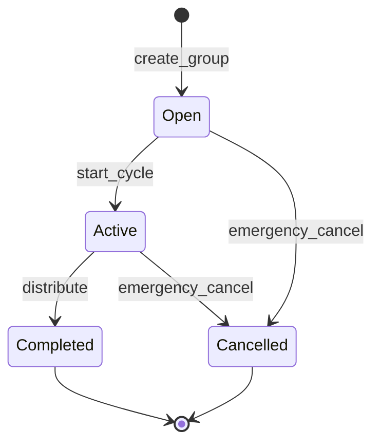
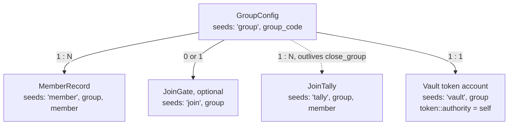

# SafeNudge

**A group savings program on Solana, for Brazilian caixinhas, MOAIs and vaquinhas.**

[](https://github.com/davigiroux/safenudge.xyz/actions/workflows/ci.yml)
[](https://www.anchor-lang.com/)

Friends agree to deposit a fixed amount every period into a shared vault that no person controls. The program records who made each deposit. When the cycle ends, every member gets back exactly what they deposited. A missed deposit costs no principal; it is simply visible to the group ([ADR-0005](./docs/adr/0005-deposits-always-returned.md)).

This repository holds the program. Its client is **SafePool**, an app in a private repository by the same author. The hackathon web app that once lived here and at safenudge.xyz is retired; [`CONCEPT.md`](./CONCEPT.md) and [`ROADMAP.md`](./ROADMAP.md) describe that proof of concept and are kept as history.

---

## How a group works



1. **Create.** The creator sets the deposit amount, the frequency (weekly, biweekly or monthly), the number of periods and the maximum group size.
2. **Join.** Members join with the group code and make their first deposit. A join names the terms the member was shown, and fails if the group no longer has them. Until the cycle starts, a member can leave and take that deposit back.
3. **Start.** The creator starts the cycle; no one can join after that.
4. **Deposit.** Each period, each member deposits the fixed amount.
5. **Distribute.** After the last period, anyone can settle the group. Every member gets back what they deposited, and the vault closes.
6. **Emergency cancel.** At any point before settlement, the creator can return every member's deposits.

Afterwards, permissionless instructions return each account's rent to the wallet that paid it, and `close_group` frees the group code.

## Accounts



The vault's address and authority are the same PDA, so no human key can ever sign a transfer out of it. A JoinGate makes every join need a join authority's signature. A JoinTally counts one member's joins at a group address across leaves and rejoins.

## Instructions

| Instruction | Who can call | Fund movement | Required status |
|---|---|---|---|
| `create_group` | Anyone (`rent_payer` signs and pays rent). Rejects unsupported mints | None | — |
| `join_group` | Anyone. A gated group also needs its join authority's signature | Member → Vault | Open |
| `leave_group` | The member | Vault → that member | Open |
| `start_cycle` | Creator | None | Open |
| `deposit` | Members | Member → Vault | Active |
| `distribute` | Anyone, after the cycle ends | Vault → every member, exactly what each deposited | Active |
| `emergency_cancel` | Creator | Vault → every member, exactly what each deposited | Open or Active |
| `refund_vault_rent` | Anyone | Vault rent (SOL) → the wallet that paid it | Completed or Cancelled |
| `close_member_record` | Anyone | Record rent (SOL) → the wallet that paid it | 30 days after settlement |
| `close_group` | Anyone | Group and gate rent (SOL) → the wallet that paid it | Settled, every record closed |
| `set_join_authority` | Creator | None | Open, no member yet |
| `close_join_tally` | Anyone | Tally rent (SOL) → the wallet that paid it | After `close_group` |

Full specs are in [`ARCHITECTURE.md`](./ARCHITECTURE.md).

## Security model

1. **No admin path to funds.** The program has no owner, no admin role and no fee. Vault tokens go only to the members recorded in the group. The creator can start or cancel, and a cancel returns each member's deposits.
2. **PDA-only vault authority.** No wallet can sign a transfer out of a vault.
3. **One-directional state machine.** `Open → Active → Completed/Cancelled`. Every instruction checks status first.
4. **Deposits always come back.** `distribute` pays each member their recorded `total_deposited`, and fails unless the vault holds the sum. All arithmetic is checked, and CI denies raw arithmetic and lossy casts.
5. **Permissionless settlement.** Anyone can settle a finished cycle.
6. **`transfer_checked` everywhere,** and a mint allowlist: `create_group` rejects wrapped SOL and any Token-2022 mint with an extension outside metadata and interest-bearing.

**Known limit.** Settlement pays every member in one transaction, so a frozen member token account blocks it until the account is thawed or the caller passes another token account of that member. A claim path is planned in [issue #56](https://github.com/davigiroux/safenudge.xyz/issues/56).

**Upgrade authority.** On mainnet the upgrade authority is a 2-of-3 Squads multisig. Making the program immutable waits on an external review and a mainnet soak; see [ADR-0001](./docs/adr/0001-defer-program-immutability-to-multisig.md). Until then, read the guarantees above as "no single party can move your money", not "the rules can never change".

Threat model and instruction matrix: [`ARCHITECTURE.md`](./ARCHITECTURE.md#security-architecture). Engineering rules: [`CLAUDE.md`](./CLAUDE.md#security-principles).

## Build and test

| Tool | Version |
|---|---|
| Rust | stable |
| Solana CLI | v3.1.10 |
| Anchor CLI | 1.0.2 (`cargo install --git https://github.com/coral-xyz/anchor --tag v1.0.2 anchor-cli --locked`) |
| Node.js | 24 (Node 20 and 22 crash the LiteSVM suite) |

```bash
npm install
anchor build --ignore-keys
npx ts-mocha -p ./tsconfig.json -t 1000000 'tests/**/*.ts'
```

Per-cluster builds:

```bash
anchor build --ignore-keys                          # local and tests
anchor build -- --features devnet                   # five-minute periods for testing
anchor build --ignore-keys -- --features mainnet    # mainnet program ID; never `anchor keys sync`
```

After a change to the program interface, copy the IDL into `idl/` (CI checks it matches the build):

```bash
cp target/idl/safenudge.json idl/ && cp target/types/safenudge.ts idl/safenudge-types.ts
```

Deploying and rehearsing on devnet: [`docs/devnet-testing.md`](./docs/devnet-testing.md). Monitoring: [`docs/monitoring.md`](./docs/monitoring.md).

## Repository

```
safenudge.xyz/
├── programs/safenudge/src/   # Anchor program: lib.rs, instructions/, state/, errors.rs, events.rs
├── tests/                    # LiteSVM integration tests
├── idl/                      # Committed IDL; SafePool and monitoring copy it
├── ops/                      # Watchdog and monitoring bundle
├── scripts/                  # measure-join.ts, rehearse-devnet.ts
├── docs/                     # ADRs, devnet guide, monitoring
├── ARCHITECTURE.md           # Account layouts, instructions, security
└── CLAUDE.md                 # Engineering rules and review checklists
```

---

## License

Licensed under the [Apache License, Version 2.0](./LICENSE). You may use, modify, and redistribute this code, including for commercial purposes, subject to the conditions of the license — most notably, preserving copyright and license notices in derivative works. The Apache 2.0 patent grant is included.

## Contributing

This is a personal project, not actively seeking contributors. Forks and derivative works are welcome under the license. See [`CONTRIBUTING.md`](./CONTRIBUTING.md) for what to expect if you open an issue or PR.

## Author

Davi Giroux — 2026. Copyright 2026 Davi Giroux, licensed under Apache-2.0.
